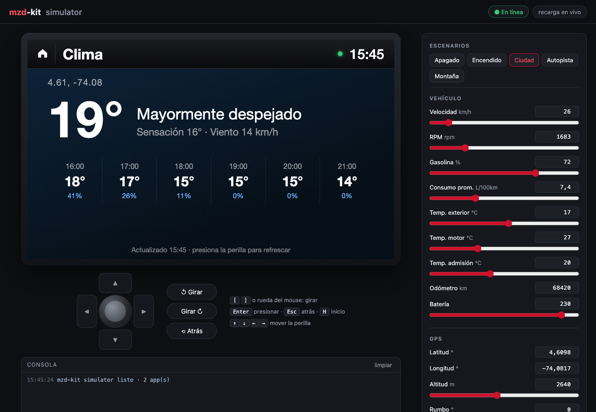
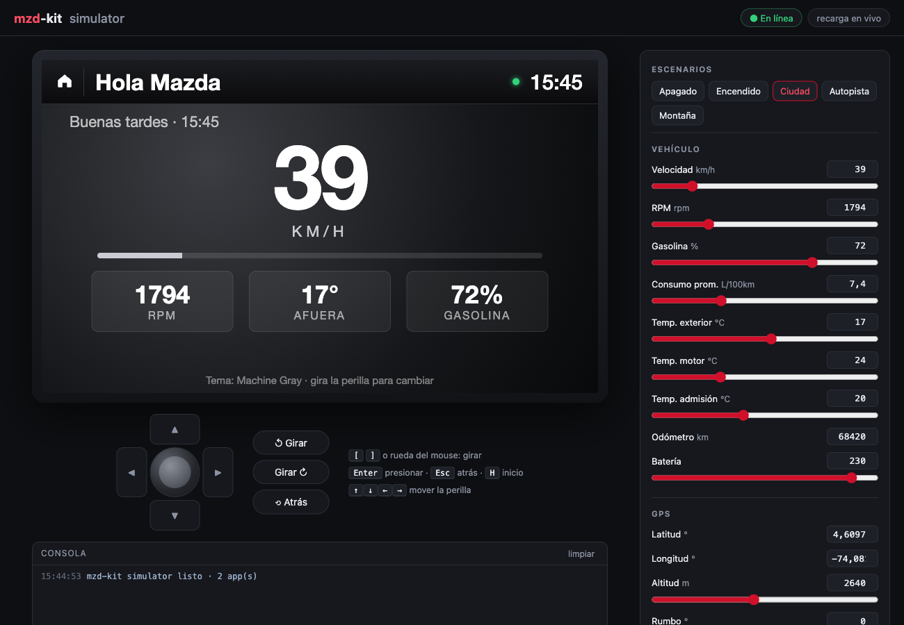
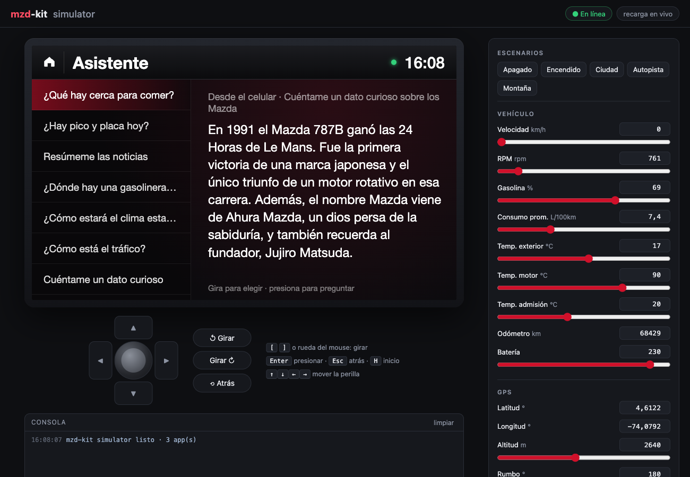
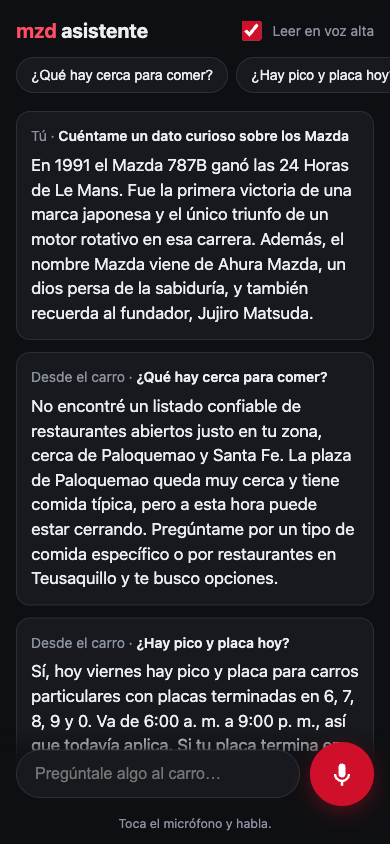

# mzd-kit

**Build apps for the Mazda Connect infotainment system with modern JavaScript.**
SDK · simulator · ES5 compiler · internet bridge — in one `npm` package.



Mazda Connect (the "CMU", 2014–2020 Mazda 2/3/6/CX-3/CX-5/CX-9/MX-5) runs a web-based UI on a
2013-era WebKit. The community [Custom Applications SDK](https://github.com/flyandi/mazda-custom-application-sdk)
made it possible to run your own apps on it, but it was left unfinished in 2016.
**mzd-kit** is a from-scratch, MIT-licensed toolkit that keeps compatibility with the CASDK
host already installed on cars (via MZD-AIO-TI) and makes writing apps pleasant again:

- **Modern JS in, ES5 out.** Write `const`, arrow functions, template strings, classes and
  `import`s. `mzd build` bundles, lowers to ES5 and *verifies* the output parses as ES5.
- **Plain CSS, auto-scoped.** Your CSS is scoped to your app and prefixed for old WebKit.
- **A friendly SDK.** `app.car.on('speed')`, `app.controls.on('rotate')`, `app.store`, `app.net`.
- **A real simulator.** 800×480 screen, commander knob (keyboard + mouse wheel), live vehicle
  data, driving scenarios (city, highway, mountain) with moving GPS, online/offline toggle,
  console, live reload.
- **Internet for the car.** The CMU browser can't speak modern TLS and has little RAM. The
  **bridge** does the heavy lifting on a phone/laptop/server and hands the car small JSON.
  `app.net` adds timeouts and an offline cache, because signal comes and goes on the road.
- **An AI assistant (Claude).** Pick a quick phrase with the knob, or talk to it from your phone;
  it searches the web, knows where the car is, answers in a few glanceable sentences and the
  phone reads the answer aloud.

> ⚠️ **Status: v0.1, early.** The SDK and simulator are tested; running on a real car requires a
> jailbroken CMU with the CASDK runtime installed and has **not yet been validated by us on
> hardware** (that's next — see [Roadmap](#roadmap)). Modifying your car's head unit is at your
> own risk.

## Quick start

```bash
npm install -g github:jeronimotech/mzd-kit   # npm package coming soon

mzd create app.mi-tablero        # new app from the template
mzd dev .                        # simulator at http://127.0.0.1:5173
mzd build . --out dist           # ES5 bundles for the car
```

Or try the examples from a clone:

```bash
git clone https://github.com/jeronimotech/mzd-kit && cd mzd-kit
npm install
npm run dev                      # runs examples/ in the simulator
```

## Writing an app

An app is a folder named `app.<name>` with an `app.js` (and optionally `app.css` and a `public/`
folder for images and fonts).

```js
// app.mi-tablero/app.js
import { defineApp, h, fmt } from 'mzd-kit';
import './app.css';

defineApp({
  title: 'Mi Tablero',

  setup(app) {
    const speed = h('div', { class: 'speed' });
    app.root.appendChild(speed);

    app.car.on('speed', (kmh) => { speed.textContent = fmt(kmh); });
    app.controls.on('rotate', (dir) => { /* dir is 1 or -1 */ });
    app.controls.on('press', () => { /* knob pressed */ });

    return app.every(1000, () => { /* runs while the app lives */ });
  },
});
```

```css
/* app.mi-tablero/app.css — scoped automatically, write it plainly */
.speed { font-size: 160px; text-align: center; }
```

See [docs/API.md](docs/API.md) for the full API, and [`examples/`](examples) for
**Hola Mazda** (dashboard + themes) and **Clima** (weather via the bridge, with offline cache).



## The simulator

`mzd dev <dir>` builds every app on change and serves the simulator:

| Input | Action |
|---|---|
| `[` `]`, `q` `e`, mouse wheel over the screen | Rotate the knob |
| `Enter` / `Space` | Press the knob |
| Arrow keys | Push the knob up/down/left/right |
| `Esc` / `Backspace` | Back |
| `H` | Home (app list) |

The side panel lets you set any vehicle signal, play scenarios (the car actually moves: GPS
follows speed and heading), and cut the internet to test offline behavior. The simulator
implements the same host interface as the car (`CustomApplicationsHandler`), so it runs the exact
same compiled file you'll install.

## The AI assistant



The bridge can run [Claude](https://www.anthropic.com/claude) (`claude-opus-5-5` with web
search) as an in-car assistant. Questions come from two places and land in one shared feed:

- **The car** — `app.ai.ask('¿Hay pico y placa hoy?')`, e.g. from a knob-driven list of quick phrases.
- **The phone** — open `http://<bridge>/companion`: talk (Web Speech API) or type; the answer
  shows on the car screen and the phone reads it aloud.



```bash
ANTHROPIC_API_KEY=sk-ant-… MZD_ASSISTANT_CITY=Bogotá MZD_ASSISTANT_TIMEZONE=America/Bogota mzd dev examples
```

The key lives only on the bridge, never in the car or in app code. The car's approximate
location and speed are sent to the model as context. See [docs/ASSISTANT.md](docs/ASSISTANT.md).

## The bridge

```bash
MZD_BRIDGE_TOKEN=change-me mzd bridge --port 7070
```

| Endpoint | What it does |
|---|---|
| `GET /v1/ping` | Health check |
| `GET /v1/weather?lat=&lon=` | Current weather + next hours ([Open-Meteo](https://open-meteo.com), no key), Spanish descriptions |
| `GET /v1/proxy?url=` | Fetch any http(s) URL for the car (≤1 MB; requires a token when public) |
| `GET/POST /v1/assistant/ask` | Ask the AI assistant (returns immediately; the answer arrives in the feed) |
| `GET /v1/assistant/feed?since=` | New and updated questions/answers |
| `GET /companion` | Phone page: voice/text questions, answers read aloud |

In the simulator the bridge is mounted at `/bridge`, so `app.net.get('/v1/weather?…')` just
works. On the car, set the bridge address with `defineApp({ bridge: 'http://…' })`.
See [docs/BRIDGE.md](docs/BRIDGE.md).

## Installing on the car

See [docs/INSTALL.md](docs/INSTALL.md). In short: your CMU must be jailbroken and have the CASDK
runtime installed (MZD-AIO-TI); `mzd build` produces folders you copy into the CMU's apps
directory plus an `apps.js` listing them.

## Roadmap

- [ ] Validate on real hardware (firmware v70.00.367, Mazda 3 2017) and document the full path
- [ ] App-list integration for firmware newer than v70.00.335
- [ ] `mzd deploy` over SSH/Wi-Fi to a jailbroken CMU, with hot reload on the car
- [ ] USB installer package generation
- [x] AI assistant with web search, phone voice companion
- [ ] Use the CMU's own microphone on a jailbroken unit (native capture → bridge)
- [ ] More bridge services: news, traffic, music metadata
- [ ] UI kit: gauges, charts, maps, dialogs, night mode
- [ ] Record & replay real drive data in the simulator
- [ ] Publish to npm

## Contributing

Issues and PRs are welcome. `npm test` runs the suite (build pipeline, SDK, bridge).

## Credits & license

MIT © JeronimoTech. mzd-kit is an independent project, not affiliated with Mazda Motor Corporation.
"Mazda" and "Mazda Connect" are trademarks of their owners.
It interoperates with the CASDK host API by Andreas Schwarz ([flyandi](https://github.com/flyandi))
and the MZD-AIO-TI project ([Trevelopment](https://github.com/Trevelopment)); no code from those
GPL-3.0 projects is included.

---

### 🇨🇴 En español

**mzd-kit** es un kit para crear apps para el sistema Mazda Connect con JavaScript moderno:
SDK, simulador, compilador a ES5, un **puente a internet** para que las apps nativas del carro
puedan usar servicios en línea con caché offline, y un **asistente de IA** (Claude) al que le
preguntas con la perilla o por voz desde el celular. Empieza con `mzd create app.mi-app` y
`mzd dev .`. La documentación de la API está en [docs/API.md](docs/API.md).
